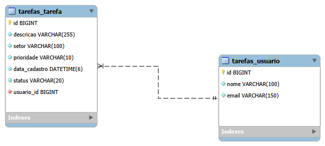

<h1 align="center">📋 Gerenciador de Tarefas</h1>

  Sistema web para gerenciamento e acompanhamento de atividades utilizando um quadro Kanban.

  
  
  
  

💻 Sobre o projeto

O Gerenciador de Tarefas é uma aplicação web desenvolvida como atividade prática do curso de Desenvolvimento de Sistemas do SENAI.

O sistema permite cadastrar usuários, distribuir tarefas entre responsáveis e acompanhar o andamento das atividades de diferentes setores por meio de um quadro Kanban.

✨ Funcionalidades

Recurso

Descrição

👤 Usuários

Cadastro de usuários e e-mails

📝 Tarefas

Cadastro de atividades e setores

🚦 Prioridades

Classificação baixa, média e alta

🔄 Atualizações

Alteração de status e prioridade

📊 Kanban

Visualização das tarefas por etapa

Fluxo das tarefas

  <strong>📝 A fazer</strong> &nbsp; ➜ &nbsp;
  <strong>⚙️ Fazendo</strong> &nbsp; ➜ &nbsp;
  <strong>✅ Pronto</strong>

🛠️ Tecnologias

  

🗄️ Banco de dados

O banco de dados possui duas entidades principais:

Usuario: armazena os dados dos usuários.

Tarefa: armazena as atividades e está vinculada a um usuário por meio de uma chave estrangeira.

O relacionamento é de um para muitos (1): um usuário pode possuir várias tarefas, e cada tarefa pertence a um único usuário.

Diagrama entidade-relacionamento

  

🚀 Como executar

1. Clone o repositório

git clone https://github.com/gslarie/gerenciador_tarefas.git
cd gerenciador_tarefas

2. Crie o ambiente virtual

python -m venv venv

No Windows PowerShell:

.\venv\Scripts\Activate.ps1

3. Instale as dependências

pip install -r requirements.txt

4. Configure o banco de dados

Crie um banco MySQL chamado gerenciador_tarefas e um arquivo .env na raiz do projeto:

DJANGO_SECRET_KEY=sua_chave_secreta
DB_NAME=gerenciador_tarefas
DB_USER=root
DB_PASSWORD=sua_senha
DB_HOST=127.0.0.1
DB_PORT=3306

5. Execute as migrações e inicie o servidor

python manage.py migrate
python manage.py runserver

Acesse: http://127.0.0.1:8000/

👩‍💻 Autoria

Desenvolvido por Larissa
Curso de Desenvolvimento de Sistemas — SENAI

  

